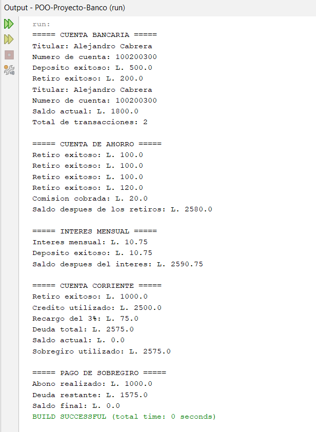

Nombre Completo: Jorge Alejandro Cabrera Aguirre
No. Cuenta: 2025200151

## Instrucciones para compilar y ejecutar

1. Abrir el proyecto `POO-Proyecto-Banco` en Apache NetBeans IDE 31.
2. Hacer clic derecho sobre el proyecto y seleccionar **Clean and Build**.
3. Abrir `Main.java`, ubicado en `src/poo/proyecto/banco/`.
4. Hacer clic derecho sobre `Main.java` y seleccionar **Run File**.
5. Verificar los resultados en la ventana **Output** de NetBeans.

## Descripción del proyecto

Sistema bancario desarrollado en Java mediante programación orientada a objetos. Incluye una cuenta bancaria general, una cuenta de ahorro y una cuenta corriente con sobregiro.

## Evidencia de compilación y ejecución

La imagen `evidencia.png` muestra los resultados de las pruebas del programa y la compilación.
## Evidencia de compilacion y ejecucion

